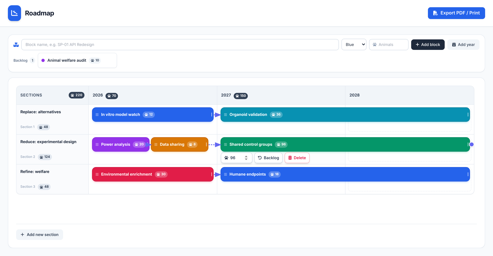

# QuatR

**A simplified Gantt roadmap for planning animal experimentation projects around the 3Rs: Replace, Reduce, Refine.**

A single HTML file: no install, no server, no account. Open it in a browser and build your roadmap by drag and drop.

**[Try it online](https://benjaws.github.io/quatr/)**

## Features

- **One continuous timeline**: years are only a visual scale. Each section is a single lane, and a block can sit anywhere along it, starting and ending wherever you want.
- **Drag-and-drop blocks**: create a block, then drop it into a section at the position you want. Edges snap to year boundaries and to neighbouring blocks; a block that would overlap another goes to a new row.
- **Backlog**: blocks not yet scheduled wait under the creation bar. Drag them onto the Gantt, or send them back to the backlog.
- **Resizable**: stretch a block with its right-hand handle, up to the end of the timeline. It stops at the next block of its row.
- **Dependency arrows**: drag from a block's purple dot to another block. Click an arrow to delete it.
- **Animal counts**: give each block a number of animals (creation bar, or the paw field under a block on hover). Totals appear per year, per section and for the whole roadmap. A block spanning several years is counted once, in the year where it starts.
- **Editable sections and years**: rename sections, add or remove sections and years.
- **Undo / redo**: step back and forward through your changes with the header buttons or Ctrl/Cmd+Z and Ctrl/Cmd+Shift+Z (Ctrl+Y also works).
- **PDF export / print**: landscape layout ready to print. In an embedded preview, a printable page opens in a new tab.

## Usage

1. Open `index.html` in your browser (Chrome, Edge, Firefox, Safari).
2. Type a name, pick a color, enter a number of animals (optional), click **Add block**.
3. Drag the block onto the Gantt.
4. Stretch it, link it to other blocks, then click **Export PDF / Print**.

An internet connection is required on load: Tailwind CSS, Font Awesome and the Inter font are loaded from CDNs.

## Current limitations

- Data is not saved: reload the page and the roadmap goes back to the starting example.
- No data export (JSON) yet.

## License

[MIT](LICENSE)
