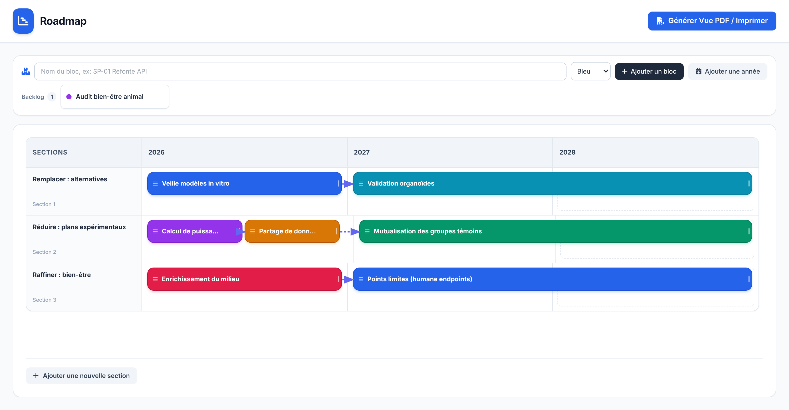

# QuatR

**Une roadmap Gantt simplifiée, pensée pour planifier des projets d'expérimentation animale autour des 3R : Remplacer, Réduire, Raffiner.**

Un seul fichier HTML, sans installation, sans serveur, sans compte. On l'ouvre dans un navigateur et on construit sa roadmap par glisser-déposer.

**[Essayer en ligne](https://benjaws.github.io/quatr/)**

## Fonctionnalités

- **Blocs par glisser-déposer** : créez un bloc, puis déposez-le dans la section et l'année voulues.
- **Backlog** : les blocs pas encore planifiés attendent sous la barre de création. Glissez-les vers le Gantt, ou remettez-les au backlog.
- **Blocs côte à côte** : plusieurs blocs peuvent partager la même ligne dans une année.
- **Durée de 1 à 3 ans** : étirez un bloc par sa poignée de droite. Il se cale sur 1, 2 ou 3 ans.
- **Flèches de dépendance** : tirez depuis le point violet d'un bloc jusqu'à un autre. Cliquez sur une flèche pour la supprimer.
- **Sections et années modifiables** : renommez les sections, ajoutez ou retirez des sections et des années.
- **Export PDF / impression** : mise en page paysage prête à imprimer. Dans un aperçu intégré, une page imprimable s'ouvre dans un nouvel onglet.

## Utilisation

1. Ouvrez `index.html` dans votre navigateur (Chrome, Edge, Firefox, Safari).
2. Saisissez un nom, choisissez une couleur, cliquez sur **Ajouter un bloc**.
3. Glissez le bloc dans le Gantt.
4. Étirez-le, reliez-le aux autres, puis cliquez sur **Générer Vue PDF / Imprimer**.

Une connexion internet est nécessaire au chargement : Tailwind CSS, Font Awesome et la police Inter sont chargés depuis des CDN.

## Limites actuelles

- Les données ne sont pas sauvegardées : rechargez la page et la roadmap revient à l'exemple de départ.
- Pas d'export des données (JSON) pour l'instant.

## Licence

[MIT](LICENSE)
